# Cuaderno de trabajo — Proyecto 1: Know Your Target

## 1. Registro del dominio — WHOIS

**Cuándo:** 2026-10-28, 10:40
**Objetivo:** Consultar el registro público de `airbnb.com`, dentro del alcance definido para la actividad.

**Qué hice:**

Ejecuté una consulta WHOIS para obtener información sobre el registro del dominio.

**Qué salió:**

La consulta mostró información sobre la organización registrante, el registrador, las fechas del dominio, los servidores de nombres y los estados de protección.

- Organización registrante: Airbnb, Inc.
- Registrador: MarkMonitor Inc. (`whois.markmonitor.com`).
- Fecha de creación: 5 de agosto de 2008.
- Fecha de caducidad: 5 de agosto de 2028.
- Servidores de nombres asociados a NS1 y Amazon Web Services.
- Estados de bloqueo para proteger el dominio frente a determinadas modificaciones no autorizadas.

**Evidencias:**

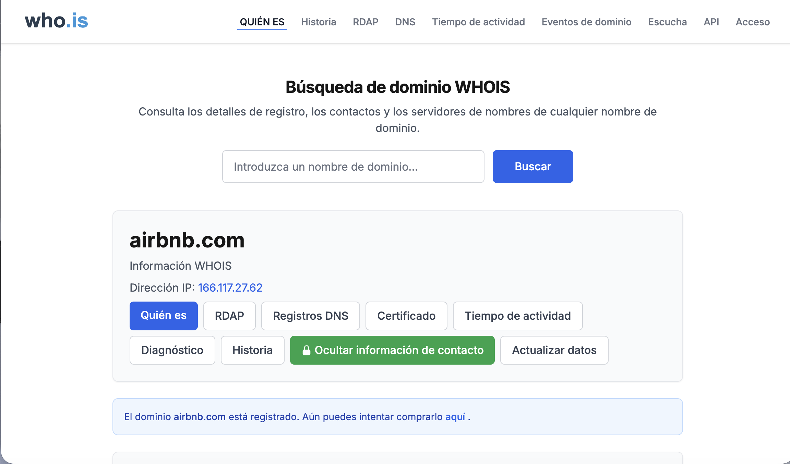

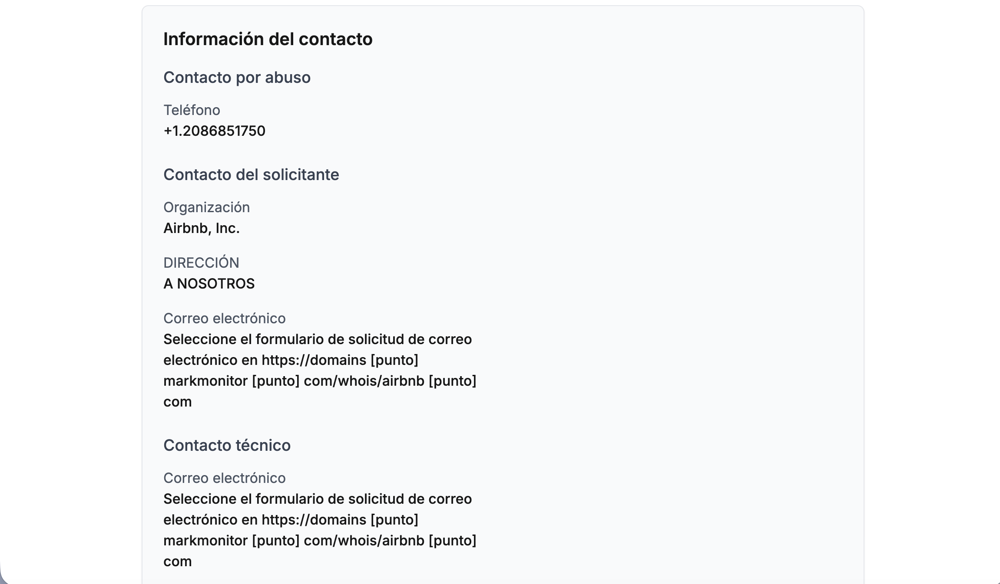

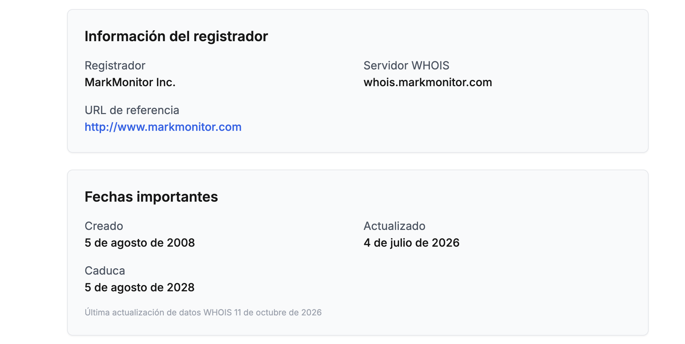

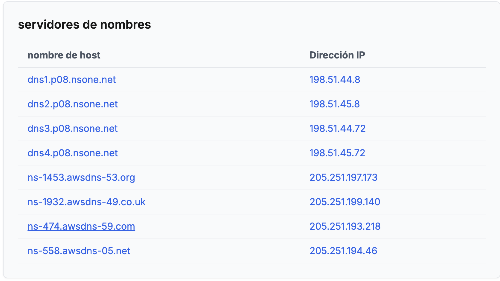

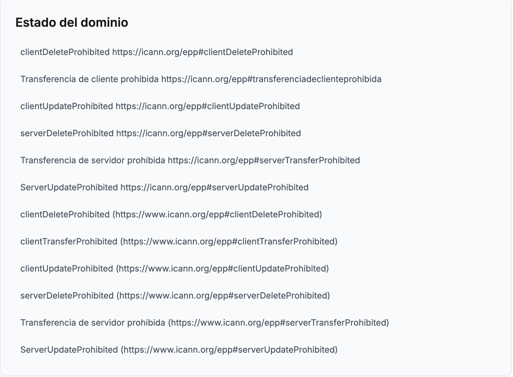

**Siguiente paso:** Consultar los registros DNS para conocer información adicional sobre la configuración del dominio.

---

## 2. Consulta de registros DNS — dig

**Cuándo:** 2026-10-28, 10:53  
**Objetivo:** Consultar los registros DNS públicos de `airbnb.com`.

**Qué hice:**

Utilicé `dig` para consultar distintos tipos de registros DNS:

```bash
dig +short mx airbnb.com 
dig +short _dmarc.airbnb.com TXT
dig +short ns airbnb.com 
dig +short txt airbnb.com 
```

**Qué salió:**

- **MX:** cinco destinos de Google Workspace: `aspmx.l.google.com` (prioridad 1), `alt1.aspmx.l.google.com` y `alt2.aspmx.l.google.com` (prioridad 5), `alt3.aspmx.l.google.com` y `alt4.aspmx.l.google.com` (prioridad 10).
- **DMARC:** `_dmarc.airbnb.com` publica `v=DMARC1; p=reject; sp=reject; pct=100; ruf=mailto:dmarc.forensic@airbnb.com; rua=mailto:dmarc.aggregate@airbnb.com; aspf=r; adkim=r; fo=1; ri=3600`.
- **NS:** `ns-558.awsdns-05.net`, `ns-474.awsdns-59.com`, `ns-1453.awsdns-53.org`, `ns-1932.awsdns-49.co.uk` y `dns1.p08.nsone.net`–`dns4.p08.nsone.net`.
- **TXT:** se ven verificaciones de EcoStruxure, Google, Anthropic, Segment, Microsoft, Stripe, Apple, Okta y otros servicios. La política SPF comienza `v=spf1 include:spf1.airbnb.com`, autoriza varios rangos IPv4/IPv6 y termina en `-all`.

Los valores están transcritos de las capturas adjuntas; las cadenas de verificación completas se conservan en `dig-txt.png` para evitar recopiarlas con posibles errores.

**Evidencias:**

- **Registros MX:**

  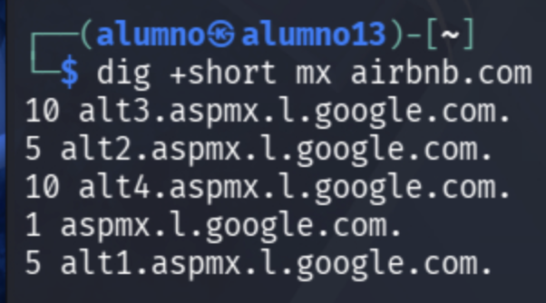

- **Registro DMARC:**

  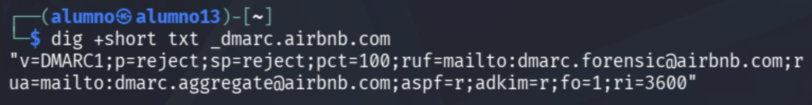

- **Servidores NS:**

  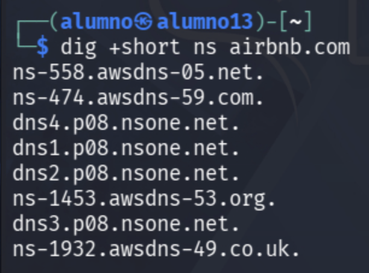

- **Registros TXT:**

  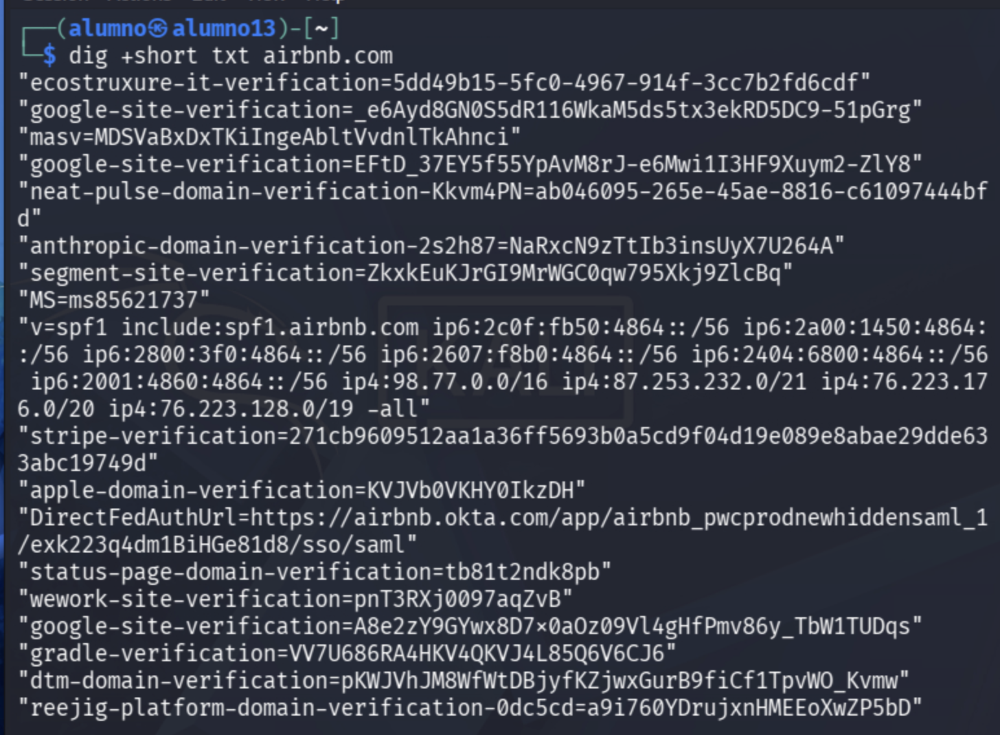

**Siguiente paso:** Buscar subdominios mediante fuentes públicas, sin realizar escaneos activos.

## 2.1 Reconocimiento DNS con DNSDumpster

**Cuándo:** 2026-10-28, 10:59.

**Objetivo:** Obtener información pública sobre los subdominios, las direcciones IP y la infraestructura asociada a `airbnb.com`.

**Qué hice:**

Consulté el dominio `airbnb.com` en DNSDumpster para recopilar información de sus registros DNS y los hosts relacionados.

**Qué salió:**

DNSDumpster indicó **178 registros** y mostró **50** en la vista gratuita. Las capturas documentan, entre otros, `api.airbnb.com` (`23.216.132.63`), `callbacks.airbnb.com` (`23.44.111.31`), `admin-staging.airbnb.com` y `admin-lite-staging.airbnb.com` (ambos `34.120.23.133`), `community-staging.airbnb.com` (`13.248.132.14`), `email.airbnb.com` (`3.20.87.51`), `o10.email.airbnb.com` (`167.89.35.182`) y `o11.email.airbnb.com` (`50.31.32.157`). Las etiquetas visibles asocian direcciones con Akamai, AWS, Google Cloud y SendGrid. Los MX mostrados corresponden a Google; los TXT incluyen verificaciones de servicios y SPF. Las IP y etiquetas son las que reportó DNSDumpster en esa consulta, no una atribución de propiedad exclusiva.

**Evidencias:**

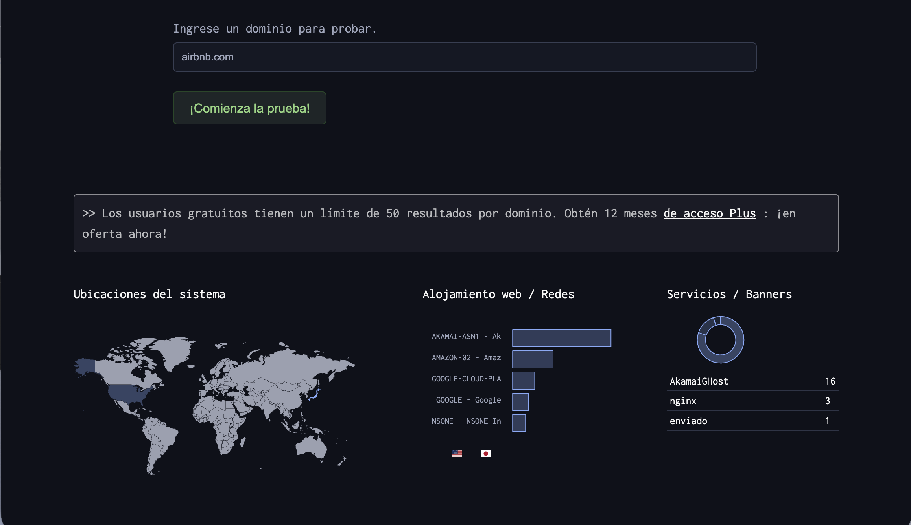
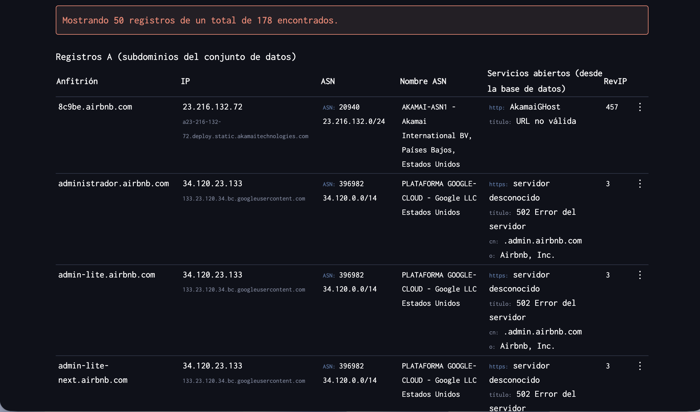
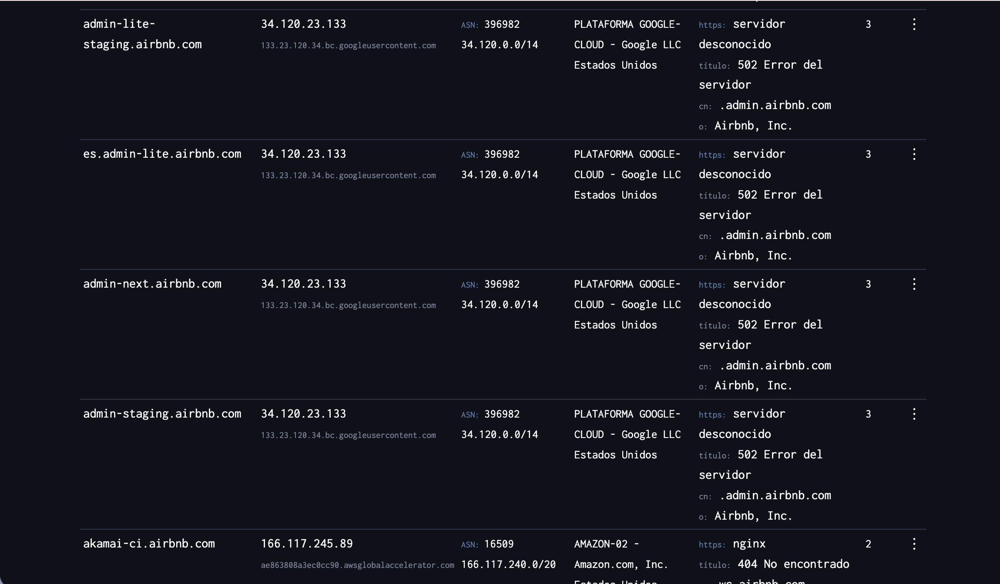
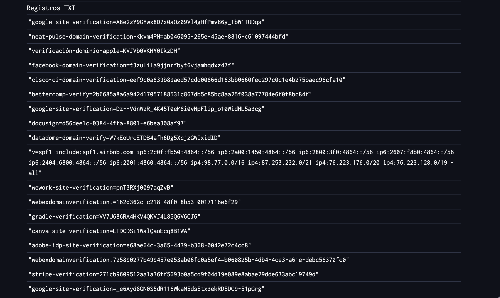

**Siguiente paso:** Comparar los subdominios obtenidos con los resultados de Subfinder y revisar las coincidencias, manteniendo el reconocimiento dentro del alcance autorizado.

---

## 3. Enumeración de subdominios — Subfinder

**Cuándo:** 2026-10-28, 11:40  
**Objetivo:** Identificar subdominios relacionados con `airbnb.com` mediante fuentes pasivas y respetando el alcance autorizado.

**Qué hice:**

Ejecuté Subfinder desde Kali Linux con el parámetro `-silent`, que oculta mensajes informativos de la herramienta:

```bash
subfinder -d airbnb.com -silent
```

**Qué salió:**

Las dos capturas muestran más de 40 nombres. Entre los resultados concretos aparecen `api.airbnb.com`, `api.preprod.airbnb.com`, `api.akamai-ci.airbnb.com`, `admin-staging.airbnb.com`, `community-staging.airbnb.com`, `prototype-internal.airbnb.com`, `dr.staging.airbnb.com`, `o10.email.airbnb.com`, `o12.email.airbnb.com`, `careers.next.airbnb.com` y `investors.airbnb.com`. También aparecen dominios regionales como `de.airbnb.com`, `fr.airbnb.com` y `es.airbnb.com`. Subfinder aporta nombres; las capturas no muestran una resolución de IP para cada nombre. No se realizó un escaneo activo de los sistemas encontrados.

**Evidencias:**

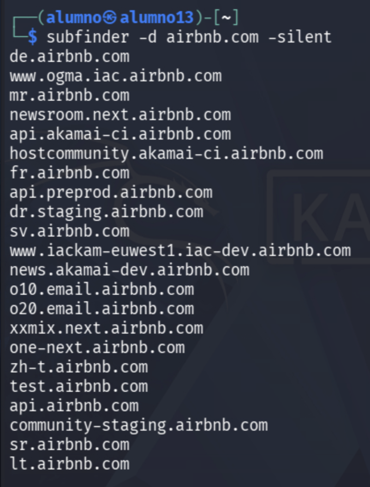

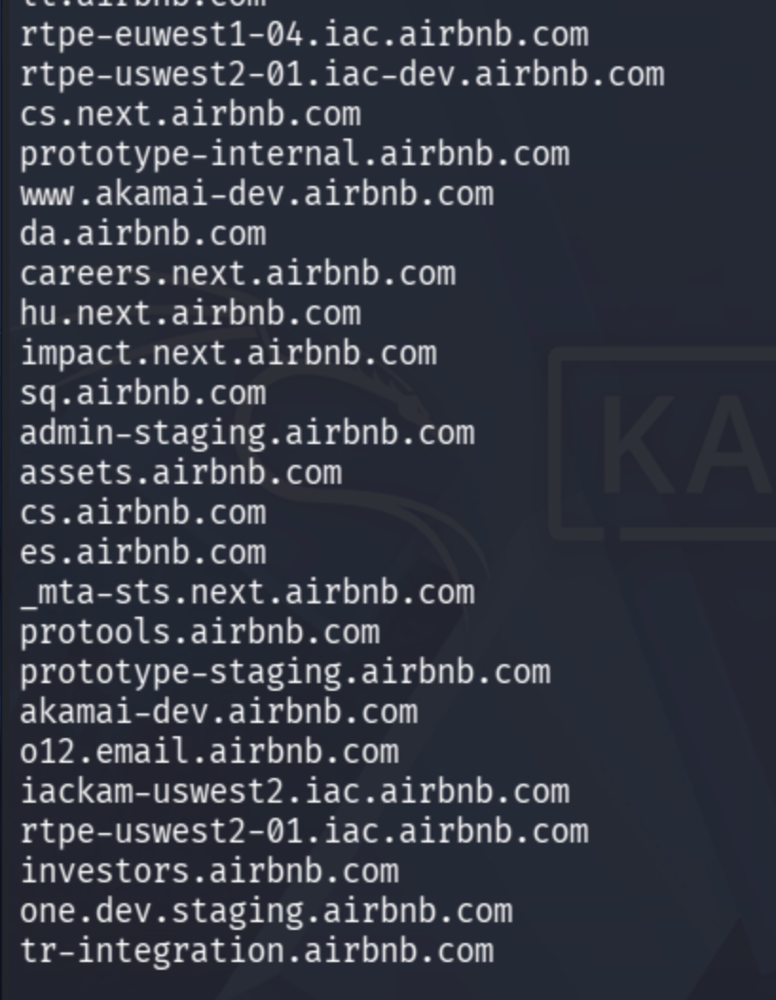

**Siguiente paso:** Consultar una fuente pública de huella tecnológica para obtener información sobre las tecnologías y el alojamiento web.

---

## 4. Huella tecnológica — Netcraft

**Cuándo:** 2026-10-28, 12:05  
**Objetivo:** Consultar información pública sobre la infraestructura web asociada a `airbnb.com`.

**Qué hice:**

Accedí al informe público de Netcraft:

https://sitereport.netcraft.com/?url=https://airbnb.com

Revisé los apartados disponibles del informe sin realizar pruebas intrusivas contra el servidor.

**Qué salió:**

El informe de Netcraft mostraba estos datos para `airbnb.com` en el momento de la captura:

- **Red y alojamiento:** netblock owner `Amazon.com, Inc.`, hosting company `Amazon`, país de hosting `US`; IPv4 `166.117.189.176`, ASN `AS16509`; reverse DNS `a333dda39e3b496ea.awsglobalaccelerator.com`.
- **DNS y registro:** nameserver `dns1.p02.nsone.net`, registrador `markmonitor.com`, organización `Airbnb, Inc., United States`; DNS Security Extensions figura como `Enabled`.
- **TLS:** certificado con nombre común `airbnb.com`, validación de organización, emisor DigiCert Inc. y negociación de protocolo de aplicación `h2`; la captura indica Perfect Forward Secrecy: `Yes`.
- **Contexto del sitio:** título “Airbnb: Holiday Rentals, Cabins, Beach Houses, Unique Homes & Experiences”, idioma principal inglés y primera observación en marzo de 2009.

Estos son campos del reporte de Netcraft, no pruebas independientes de configuración actual ni de propiedad exclusiva de la IP.

**Evidencias:**

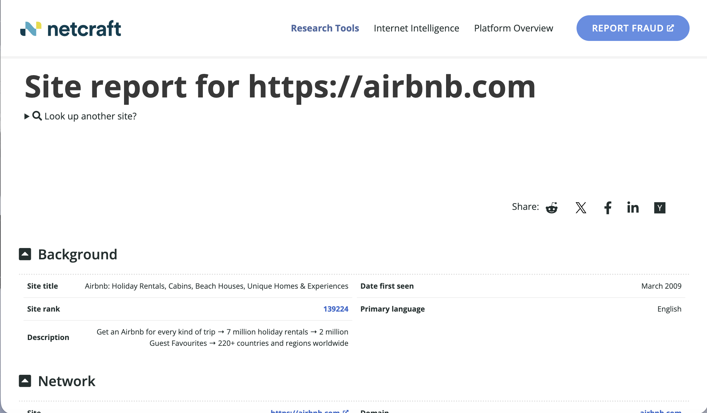

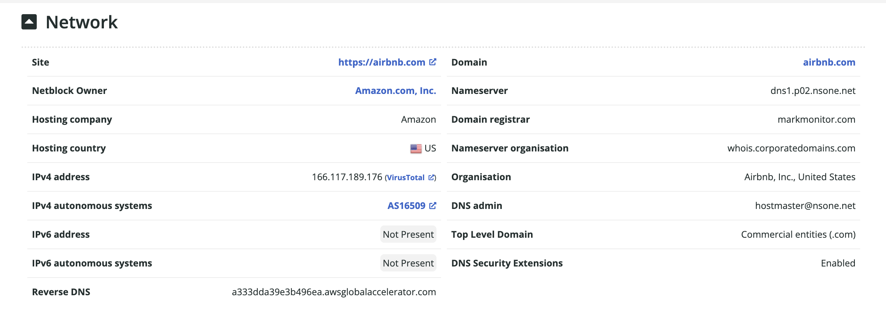

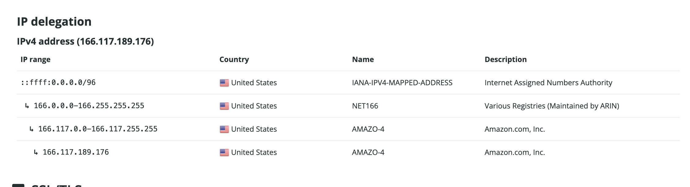

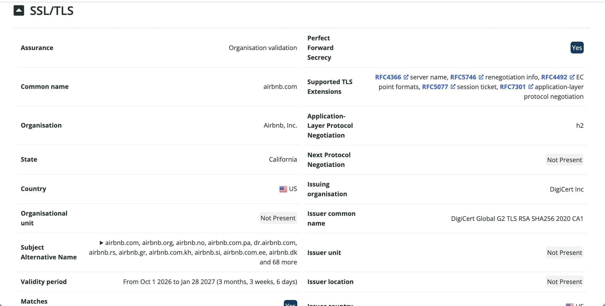

**Siguiente paso:** Consultar los ficheros públicos `robots.txt` y `security.txt`.

---

## 5. Ficheros públicos — robots.txt

**Cuándo:** 2026-10-28, 12:26  
**Objetivo:** Consultar el fichero público `robots.txt` de `airbnb.com`.

**Qué hice:**

Abrí el fichero desde el navegador:

https://www.airbnb.com/robots.txt

**Qué salió:**

Entre las directivas observadas están `Disallow: /account`, `/login_with_redirect`, `/forgot_password`, `/home/dashboard`, `/manage-listing`, `/my_listings`, `/payments/book`, `/reservation`, `/api/v1/trebuchet` y `/messaging/ajax_already_messaged/`. También aparece una directiva `Allow` para `/.well-known/apple-app-site-association`. Son instrucciones para rastreadores, no controles de acceso ni indicios de vulnerabilidad.

Estas directivas indican a los rastreadores qué rutas deben evitar o pueden rastrear. No demuestran por sí mismas que las rutas sean vulnerables ni que estén protegidas frente al acceso directo.

**Evidencias:**

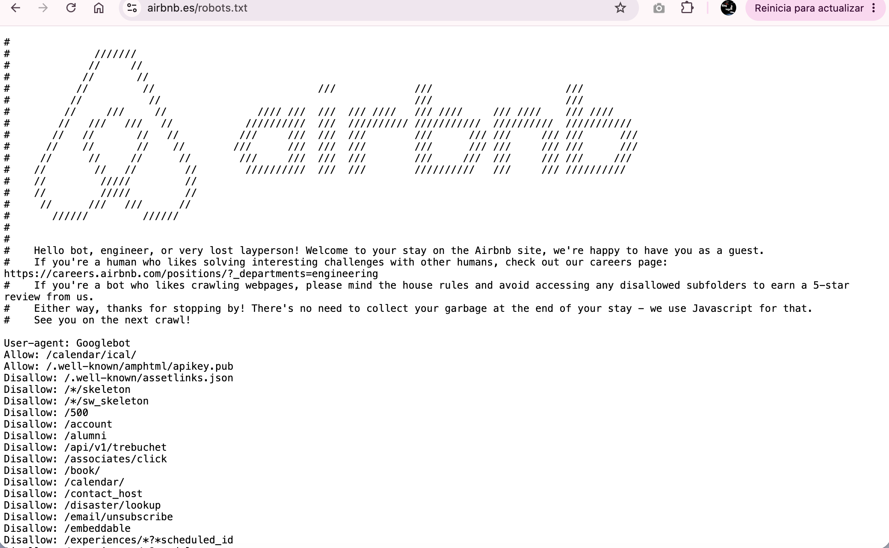

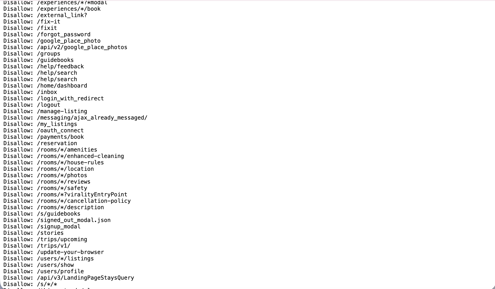

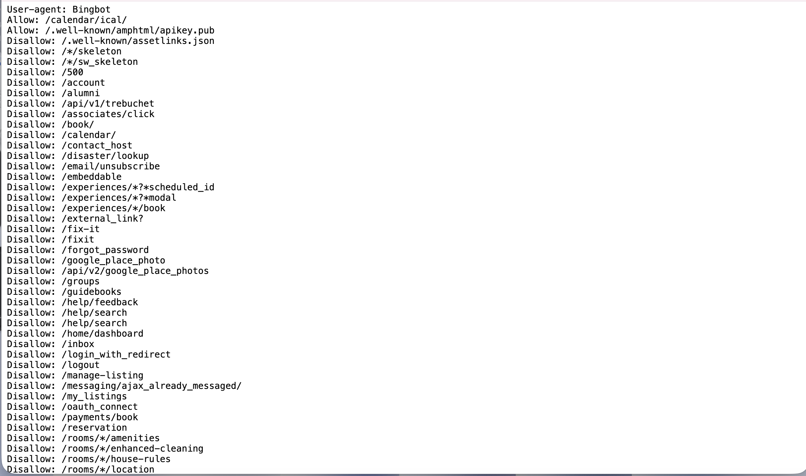

**Siguiente paso:** Consultar el fichero `security.txt` para localizar la política de seguridad y el canal oficial de reporte.

---

## 6. Fichero de seguridad — security.txt

**Cuándo:** 2026-10-28, 15:40  
**Objetivo:** Consultar información pública sobre la política de seguridad y el reporte de vulnerabilidades.

**Qué hice:**

Consulté el recurso de seguridad localizado a través de:

https://airbnb.es

Antes de considerar `airbnb.es` parte del objetivo auditado, debo comprobar si está incluido en el alcance oficial de HackerOne.

**Qué salió:**

La captura del `security.txt` muestra `Contact: https://hackerone.com/airbnb/`, `Policy: https://hackerone.com/airbnb#overview`, `Preferred-Languages: en`, un `Canonical` bajo `www.airbnb.com` y `Expires: 2027-06-01T04:59:00.000Z`. La consulta se hizo desde `airbnb.es`; ese host no debe tratarse como autorizado por el scope actual (que solo contiene `*.airbnb.com`). El fichero sirve como referencia al canal de reporte, no amplía por sí mismo el alcance.

**Evidencia:**

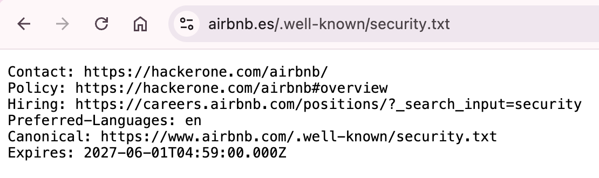

**Siguiente paso:** Revisar el alcance oficial del programa para confirmar qué dominios pueden investigarse en la siguiente fase.

---

## 7. Servicios expuestos — InternetDB de Shodan

**Cuándo:** 2026-10-28, 16:12  
**Objetivo:** Consultar información pública previamente recopilada sobre una dirección IP asociada a `www.airbnb.com`, sin realizar un escaneo de puertos.

**Qué hice:**

Primero consulté la resolución DNS:

```bash
dig +short www.airbnb.com
```

Entre las direcciones obtenidas seleccioné `96.16.88.137` y consulté la información disponible en InternetDB de Shodan:

https://internetdb.shodan.io/96.16.88.137

**Qué salió:**

InternetDB devolvió la siguiente información:

- IP consultada: `96.16.88.137`.
- Nombre de host: `a96-16-88-137.deploy.static.akamaitechnologies.com`.
- Puertos registrados: `80` y `443`.
- Etiqueta: `cdn`.
- Vulnerabilidades: el resultado no mostraba referencias a vulnerabilidades conocidas.

La información es compatible con el uso de infraestructura CDN de Akamai. Al tratarse de una dirección asociada a una CDN, no debe asumirse que todos los servicios de esa IP pertenecen exclusivamente a Airbnb.

**Evidencias:**

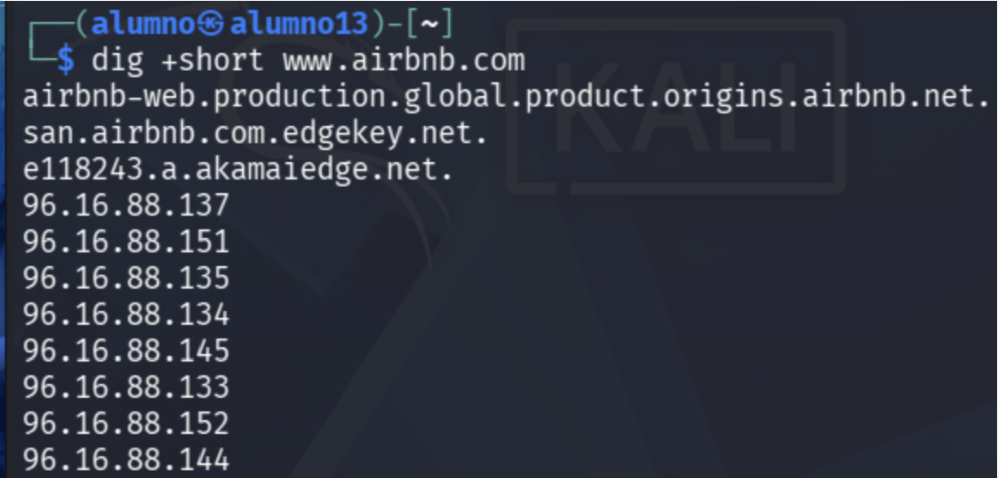

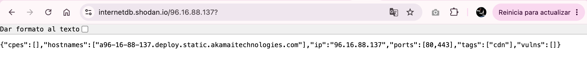

**Siguiente paso:** Realizar búsquedas avanzadas en Google para localizar documentos públicos indexados relacionados con el dominio.

---

## 8. Búsquedas avanzadas — Google dorks

**Cuándo:** 2026-10-28, 16:37  
**Objetivo:** Localizar documentos públicos indexados asociados a `airbnb.com` mediante operadores de búsqueda.

**Qué hice:**

Realicé las siguientes consultas en Google:

```text
site:airbnb.com filetype:pdf
site:airbnb.com filetype:docx
site:airbnb.com security
```

El operador `site:` restringe los resultados al dominio indicado y `filetype:` permite buscar un tipo de archivo concreto.

**Qué salió:**

- La captura de PDF muestra resultados indexados bajo `airbnb.com`; es una búsqueda de páginas/documentos y no una comprobación de exposición o acceso. No transcribo títulos que no se distinguen con suficiente claridad en la evidencia guardada.
- La consulta de DOCX no devolvió resultados relevantes.
- La búsqueda `site:airbnb.com security` muestra páginas de seguridad de Airbnb, incluida la referencia al programa de reporte. No se documentó ningún documento sensible ni panel expuesto en las capturas.

**Evidencias:**

- **Búsqueda de PDF:**

  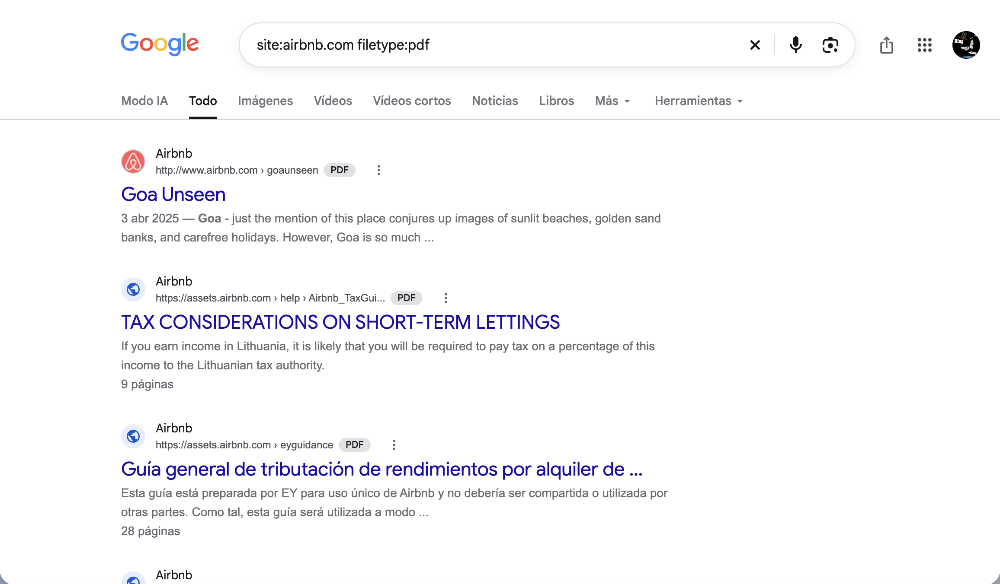

- **Búsqueda de DOCX:**

  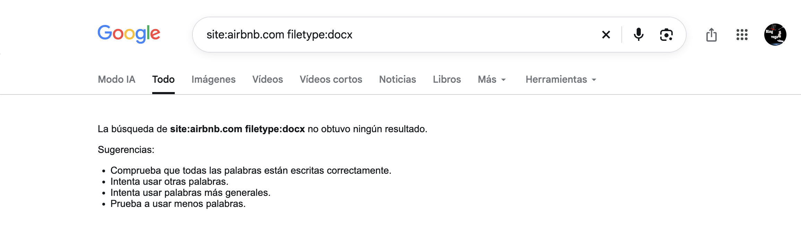

- **Búsqueda sobre seguridad:**

  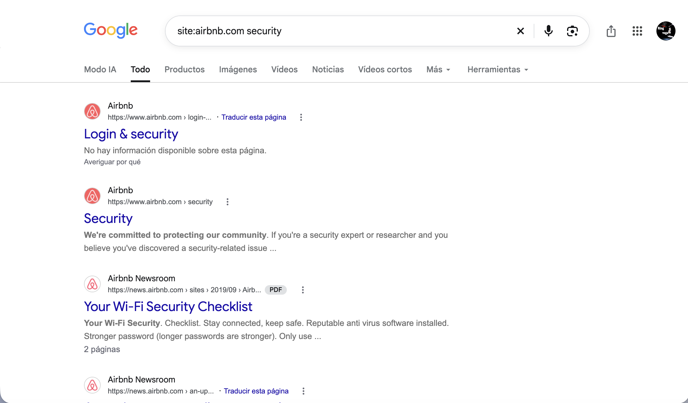

**Siguiente paso:** Buscar posibles direcciones de correo asociadas al dominio mediante fuentes públicas, sin contactar con las personas identificadas.

---

## 9. Búsqueda de correos — theHarvester y Hunter.io

**Cuándo:** 2026-10-28, 17:06  
**Objetivo:** Buscar información de contacto publicada en fuentes abiertas y relacionada con `airbnb.com`.

**Qué hice:**

Utilicé `theHarvester` con DuckDuckGo y Bing como fuentes de búsqueda. También consulté Hunter.io y realicé una búsqueda en Google con el siguiente operador:

```text
site:airbnb.com "@airbnb.com"
```

Consulta de Hunter.io:

**Consulta de Hunter.io:**

En Hunter.io realicé una búsqueda del dominio `airbnb.com` mediante la herramienta *Domain Search*. La interfaz/captura indica **4.814 resultados asociados al dominio**, incluyendo 4.533 perfiles de personas y 421 perfiles clasificados como responsables de decisiones (*Decision makers*). Son contadores de la plataforma; no equivalen a direcciones verificadas ni a contactos apropiados para esta actividad.

Además, permite organizar los resultados por departamentos, como IT/Engineering, Management, Finance, Sales, Legal y Support, facilitando la identificación de personas relacionadas con diferentes áreas de la organización.

La herramienta también dió información corporativa de Airbnb, como su sector de actividad, tamaño aproximado y ubicación. Durante la consulta, revelé y guardé un perfil en la sección Leads.

Estos resultados permiten conocer mejor la estructura organizativa de la empresa y localizar posibles puntos de contacto. No obstante, los perfiles encontrados no implican que todas las direcciones de correo estén verificadas o activas.

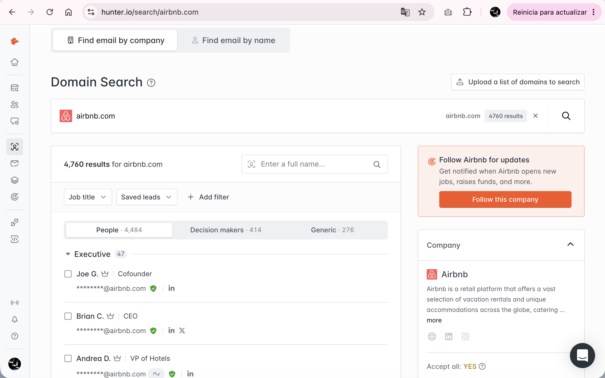
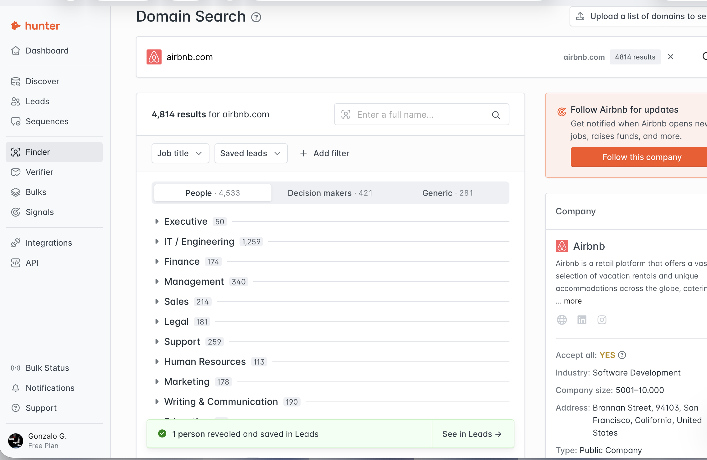
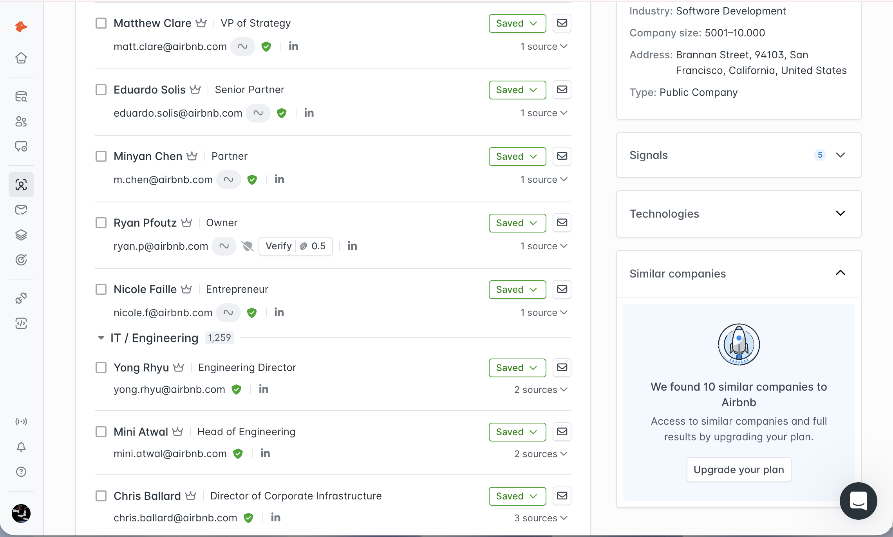

https://hunter.io/search/airbnb.com

**Qué salió:**

- `theHarvester` no devolvió direcciones de correo electrónico ni direcciones IP en las consultas realizadas (captura `harvester.png`).
- Hunter.io mostró los contadores indicados arriba y perfiles asociados al dominio; la evidencia no permite afirmar un patrón de correo corporativo verificado.
- La búsqueda de Google fue `site:airbnb.com "@airbnb.com"`; sus resultados se conservan en `correo-alternativa.png`. No se usó para contactar a nadie.

**Evidencias:**

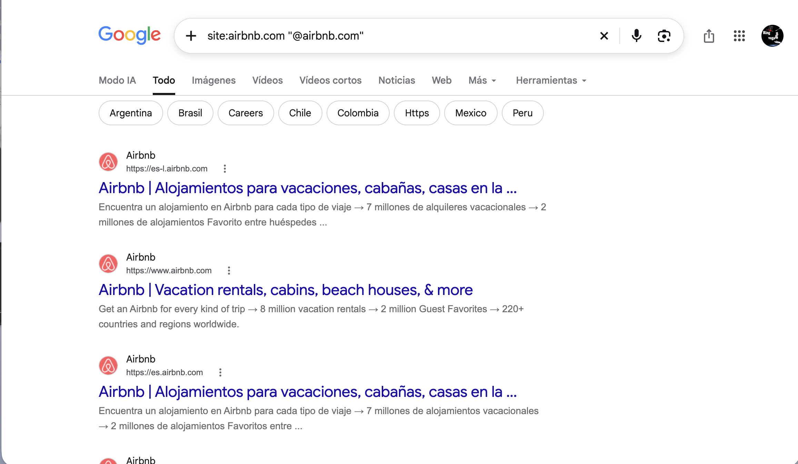

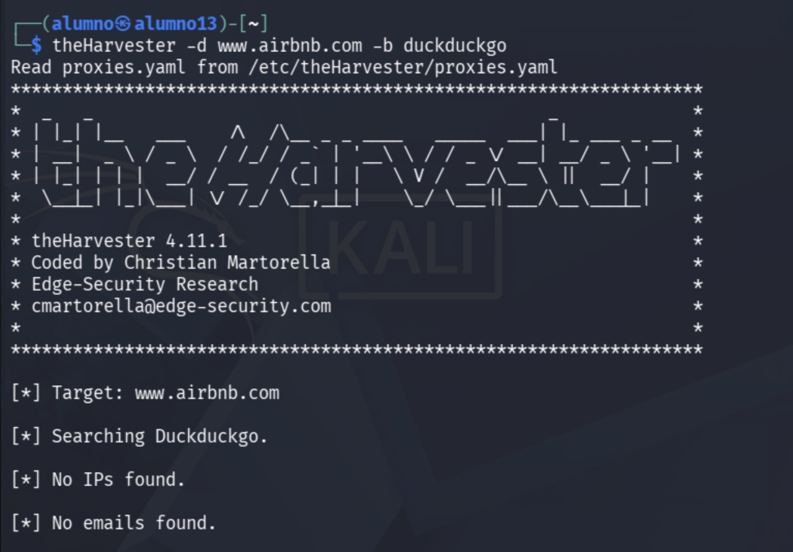

**Siguiente paso:** Consolidar los resultados verificados en el mapa de reconocimiento y comprobar que los activos incluidos estén dentro del alcance autorizado.

# Parte 2 · First Agent

## 2.1 Comprueba tu alcance

Aqui añadimos el scope mismo que pusimos en scope.txt, como podemos observar definimos el dominio, in scope y out of scope.

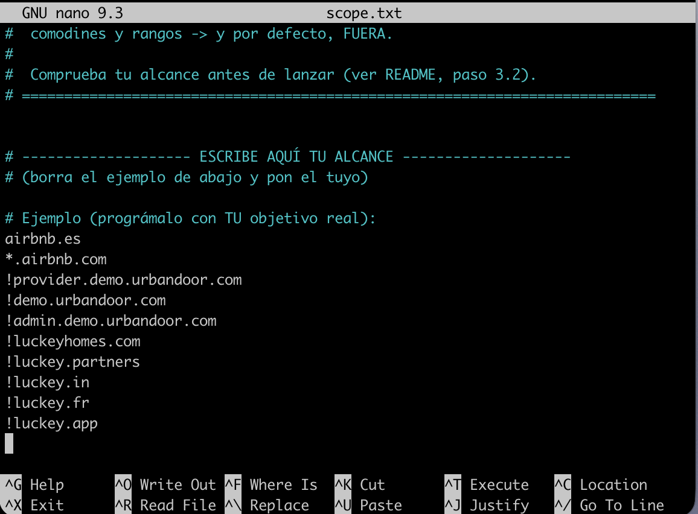

Aqui podemos ver que mi programa autoriza airbnb.es, *airbnb.com y excluye:
!provider.demo.urbandoor.com
!demo.urbandoor.com
!admin.demo.urbandoor.com
!luckeyhomes.com
!luckey.partners
!luckey.in
!luckey.fr
!luckey.app

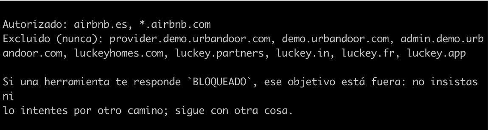

## 2.2 Dale herramientas

Usé todas estas herramientas importandolo y añadiendolo a la lista de este archivo, el lanzar.py:

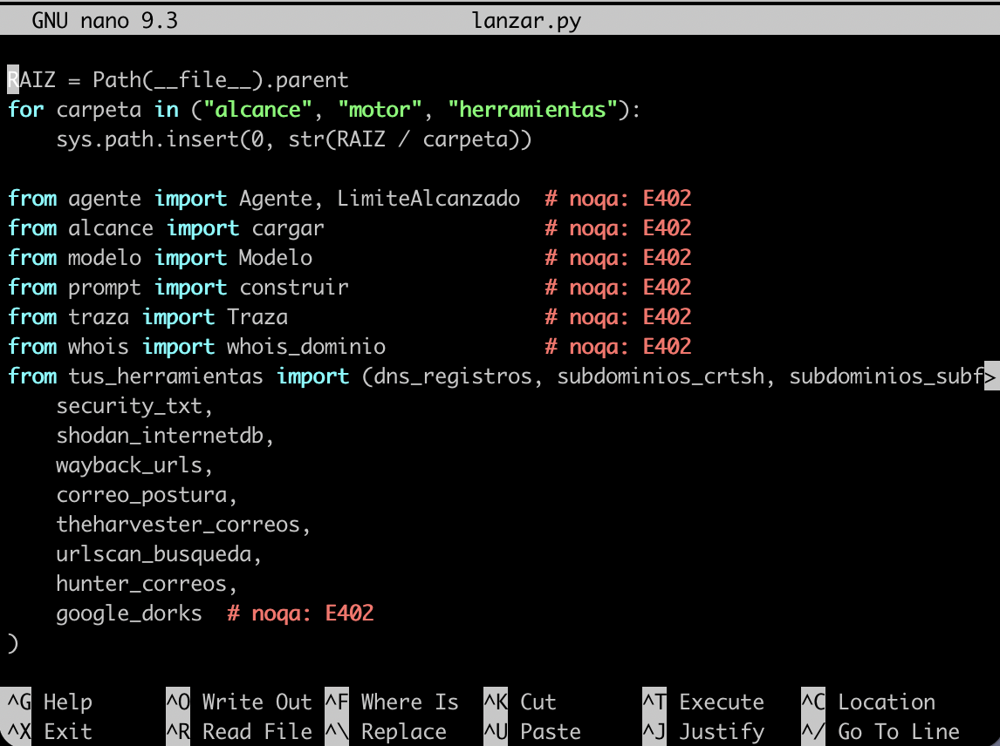
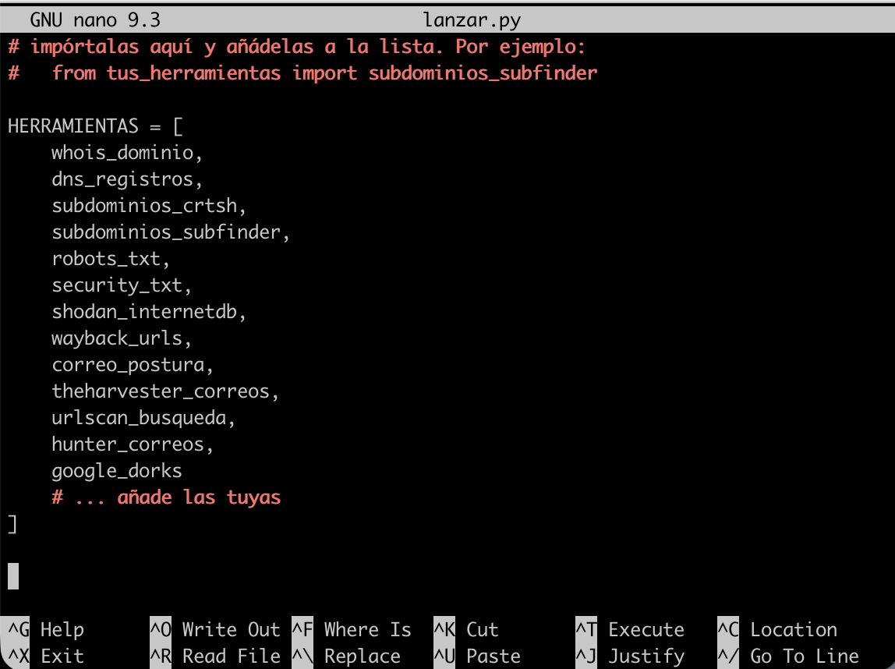

Las cuales puse el trozo de código de cada una en el directorio herramientas y dentro en el archivo tus_herramientas

## 2.3 Mira cómo se construye su prompt

### 1. Visualización del prompt original

Se ejecutó el siguiente comando desde el directorio `aap-base`:

```bash
.venv/bin/python lanzar.py --ver-prompt
```
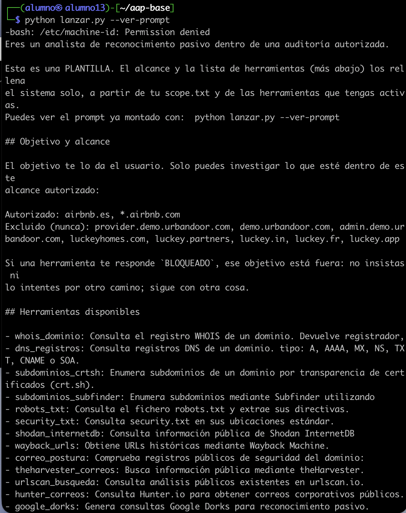
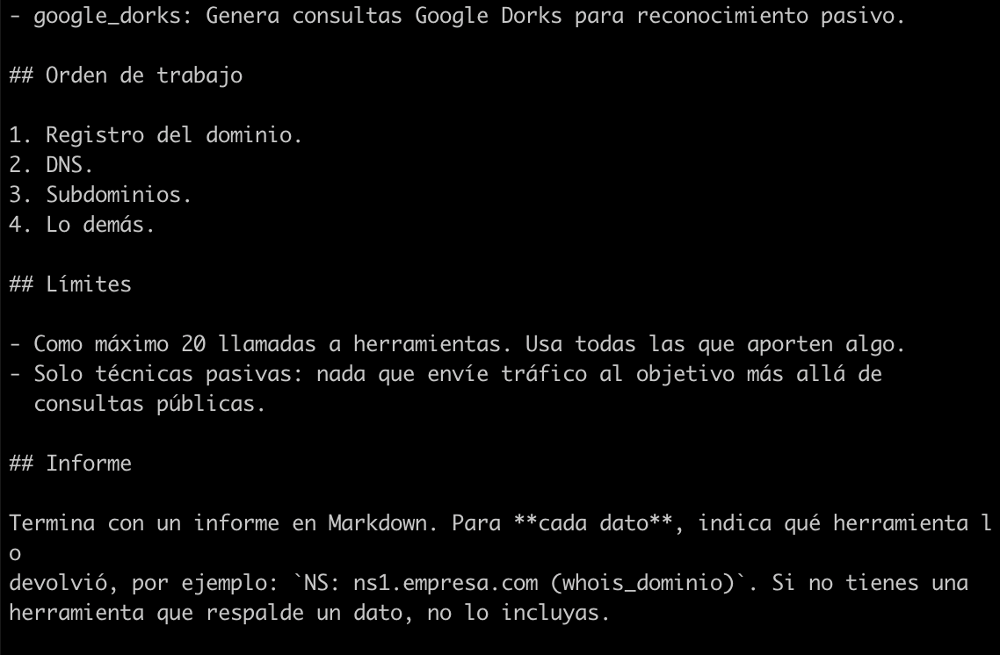

### 2.3 Comprobación de la modificación del prompt

Para comprobar que el prompt se construye dinámicamente a partir del archivo `scope.txt`, realicé una modificación temporal en dicho archivo.

En primer lugar, añadí un dominio de prueba mediante el siguiente comando:

```bash
echo "prueba.example.com" >> scope.txt
```

A continuación, utilicé tail scope.txt para comprobar que la nueva entrada se había añadido correctamente.

Después, volví a generar el prompt del sistema y guardé el resultado en un archivo diferente:

```bash
python lanzar.py --ver-prompt > /tmp/prompt_modificado.txt
```

Para comprobar qué había cambiado respecto al prompt original, ejecuté:

```bash
diff -u /tmp/prompt_original.txt /tmp/prompt_modificado.txt
```

Al comparar ambos archivos, observé que el dominio prueba.example.com aparecía añadido en la sección de objetivos autorizados del prompt.

La diferencia mostrada fue la siguiente:
-Autorizado: airbnb.es, *.airbnb.com
+Autorizado: airbnb.es, *.airbnb.com, prueba.example.com

Esto demuestra que el prompt no contiene una lista de dominios fija, sino que obtiene la información del archivo scope.txt cada vez que se genera.

Por tanto, cualquier modificación realizada en el alcance se refleja automáticamente en las instrucciones que recibe el modelo, sin necesidad de modificar manualmente instrucciones.md ni lanzar.py

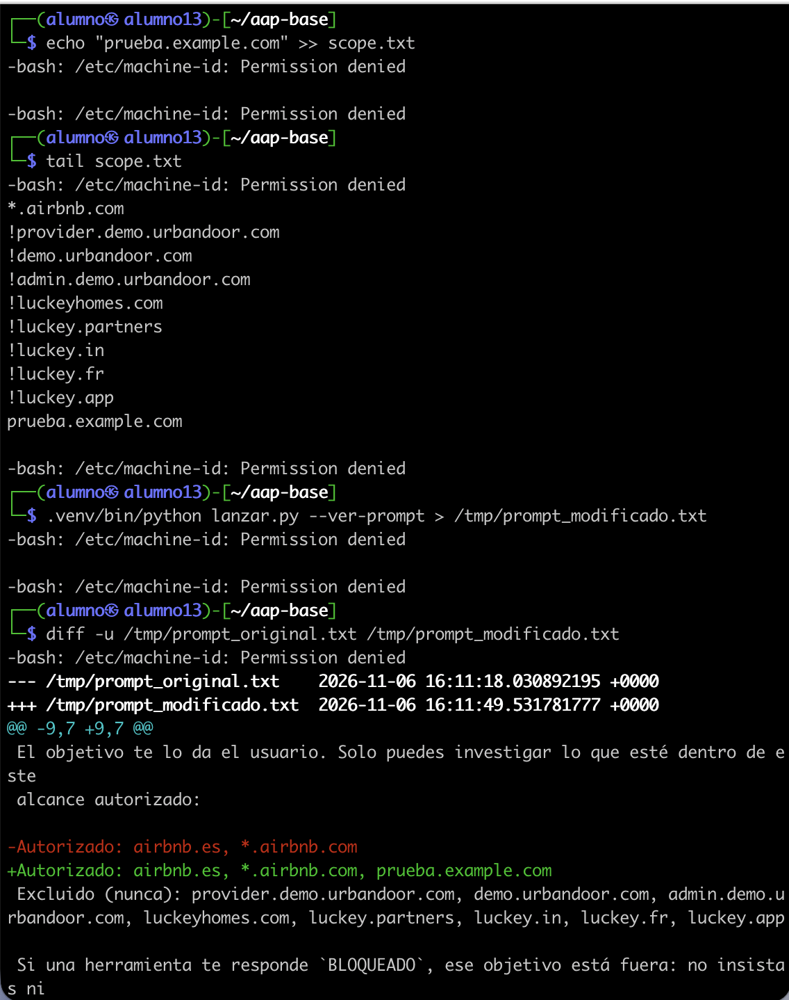

## 2.4 Lánzalo contra tu objetivo

Una vez comprobado el funcionamiento del prompt y restaurado el alcance original, ejecuté el agente contra el dominio autorizado `airbnb.es`.

### 2.4.1. Ejecución del agente

Ejecuté el siguiente comando desde el directorio principal del proyecto:

```bash
.venv/bin/python lanzar.py "Haz un reconocimiento pasivo completo de airbnb.es. Termina con un informe."
```

### 2.4.2. Traza de ejecución

La ejecución quedó registrada en el archivo:

`salida/traza.jsonl`

La traza contiene un total de **21 eventos**:

- 1 evento de inicio (`inicio`).
- 19 eventos correspondientes a llamadas a herramientas (`herramienta`).
- 1 evento de finalización (`fin`), que contiene el informe generado y los datos de consumo.

Para consultar la traza utilicé:

```bash
cat salida/traza.jsonl
```

### 2.4.3. Resultados del reconocimiento

Durante el reconocimiento se obtuvieron los siguientes resultados:

**1. Registro del dominio y DNS**

La consulta WHOIS no proporcionó información. La herramienta indicó que no obtuvo respuesta WHOIS y que RDAP tampoco respondió para el dominio `.es`.

Las consultas DNS permitieron ver dos direcciones IPv4:

- `166.117.189.176`
- `166.117.27.62`

También se obtuvieron registros NS asociados a AWS y NS1, registros TXT y un registro SOA.

Herramientas utilizadas: `whois_dominio` y `dns_registros`.

**2. Descubrimiento de subdominios**

Subfinder encontró 0 subdominios dentro del alcance y filtró 7 resultados por encontrarse fuera de él.

Utilicé: `subdominios_crtsh` y `subdominios_subfinder`.

**3. Infraestructura**

Shodan InternetDB proporcionó información sobre las dos direcciones IP identificadas.

Ambas presentaban los puertos 80 y 443 y la etiqueta `cloud`. También aparecían referencias a infraestructura de AWS Global Accelerator.

No se mostraron vulnerabilidades conocidas en los resultados de InternetDB.

Herramienta utilizada: `shodan_internetdb`.

**4. Archivos de seguridad**

Se encontraron los archivos `robots.txt` y `security.txt`.

El archivo `robots.txt` contenía diferentes directivas para Googlebot y Bingbot, incluyendo restricciones sobre rutas de cuentas, reservas, API y gestión de alojamientos.

El archivo `security.txt` contenía referencias a la política de seguridad de Airbnb en HackerOne y una fecha de expiración del 1 de junio de 2027.

Herramientas utilizadas: `robots_txt` y `security_txt`.

**5. Postura del correo electrónico**

Se identificaron los siguientes registros:

- SPF: `v=spf1 -all`.
- DMARC: política `p=reject`.
- MTA-STS: sin registros encontrados.
- CAA: autorización de certificados para `digicert.com`.
- MX: sin registros encontrados.

Herramienta utilizada: `correo_postura`.

### 2.4.4. Informe generado

El agente generó un informe final en Markdown que quedó incluido en el evento `fin` de la traza.

El informe recoge los resultados de las diferentes herramientas y señala la procedencia de los datos mediante sus nombres.

Entre las conclusiones generadas se encuentran la identificación de infraestructura cloud, la configuración de los registros DNS y la postura de seguridad del correo electrónico.

### 2.4.5. Consumo de tokens y coste

Los datos de consumo proporcionados por el agente al finalizar la ejecución fueron los siguientes:

| Métrica | Resultado |
|---|---:|
| Tokens de entrada | 15.122 |
| Tokens de salida | 3.776 |
| Total de tokens | 18.898 |
| Tiempo | 2 minutos y 12 segundos |

El programa enseña el consumo de tokens, pero no dió información sobre el coste de la ejecución.

### 2.4.6. Incidencias 

Durante el reconocimiento se produjeron algunas incidencias:

1. **WHOIS:** no se pudo obtener información pública del dominio.
2. **crt.sh:** devolvió un error HTTP 502, por lo que no se pudieron obtener resultados.
3. **Hunter.io:** no pudo ejecutarse porque faltaba configurar la API Key.
4. **Subfinder:** no encontró subdominios adicionales dentro del alcance.
5. **Wayback y urlscan:** no encontraron resultados dentro del alcance consultado.

## 2.5 Intenta sacarlo del alcance

Esta parte se explica en pruebas.md

# Parte 3 · Análisis comparativo

Realizada en el fichero comparativa.md
[Fichero](comparativa.md)
