# Cuaderno de trabajo — Proyecto 1: Know Your Target

## 1. Registro del dominio — WHOIS

**Cuándo:** 2026-10-28, 10:40
**Objetivo:** Consultar el registro público de `airbnb.com`, dentro del alcance definido para la actividad.

**Qué hice:**

Ejecuté una consulta WHOIS para obtener información sobre el registro del dominio.

**Qué salió:**

La consulta mostró información sobre la organización registrante, el registrador, las fechas del dominio, los servidores de nombres y los estados de protección.

- Organización registrante: Airbnb, Inc.
- Registrador: MarkMonitor Inc. (`whois.markmonitor.com`).
- Fecha de creación: 5 de agosto de 2008.
- Fecha de caducidad: 5 de agosto de 2028.
- Servidores de nombres asociados a NS1 y Amazon Web Services.
- Estados de bloqueo para proteger el dominio frente a determinadas modificaciones no autorizadas.

**Evidencias:**

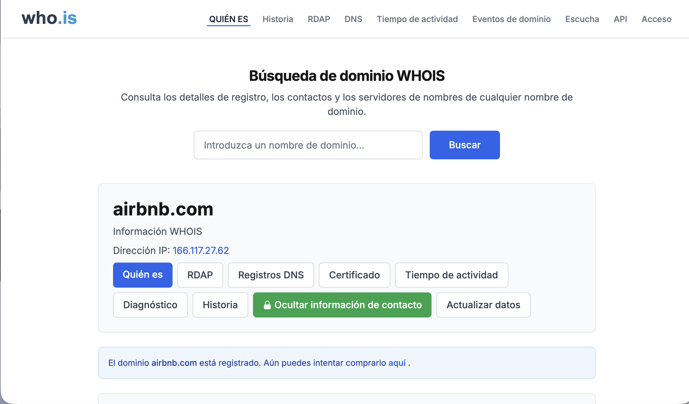

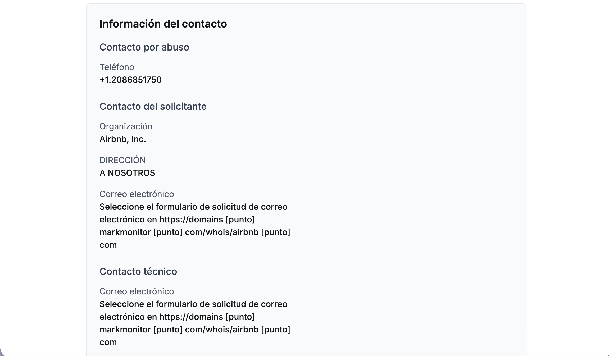

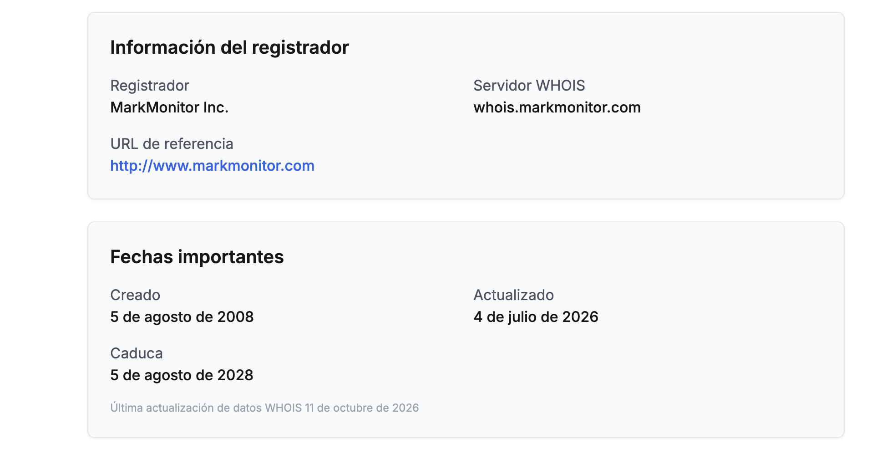

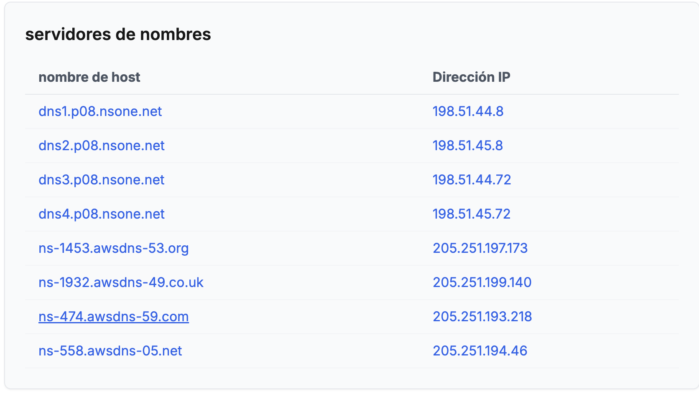

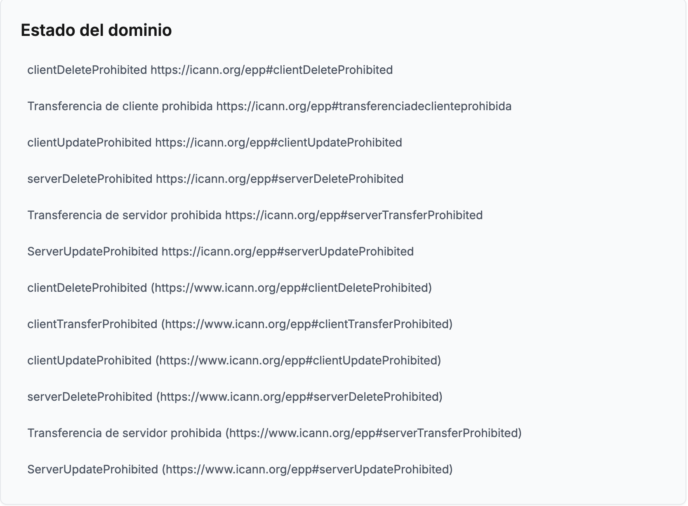

**Siguiente paso:** Consultar los registros DNS para conocer información adicional sobre la configuración del dominio.

---

## 2. Consulta de registros DNS — dig

**Cuándo:** 2026-10-28, 10:53  
**Objetivo:** Consultar los registros DNS públicos de `airbnb.com`.

**Qué hice:**

Utilicé `dig` para consultar distintos tipos de registros DNS:

```bash
dig +short mx airbnb.com 
dig +short _dmarc.airbnb.com TXT
dig +short ns airbnb.com 
dig +short txt airbnb.com 
```

**Qué salió:**

Se realizaron consultas de correo electrónico (MX), políticas DMARC, servidores de nombres (NS) y registros de texto (TXT).

**Evidencias:**

- **Registros MX:**

  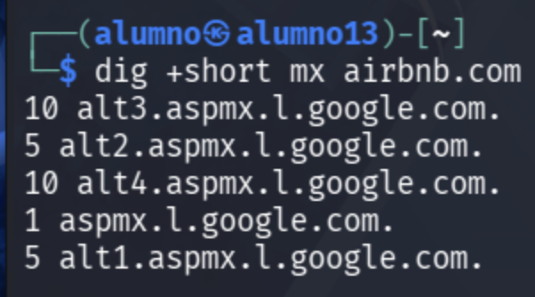

- **Registro DMARC:**

  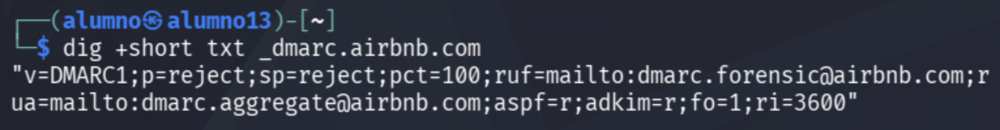

- **Servidores NS:**

  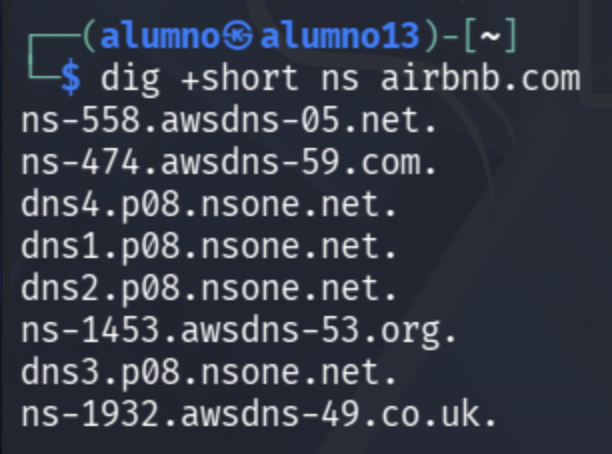

- **Registros TXT:**

  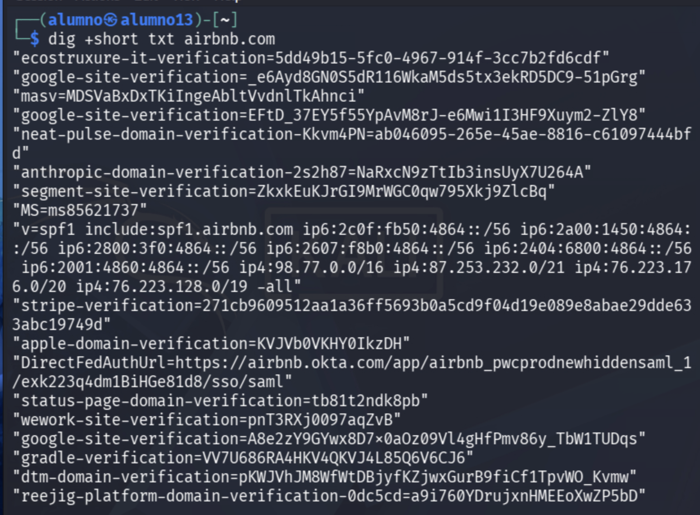

**Siguiente paso:** Buscar subdominios mediante fuentes públicas, sin realizar escaneos activos.

## 2.1 Reconocimiento DNS con DNSDumpster

**Cuándo:** 2026-10-28, 10:59.

**Objetivo:** Obtener información pública sobre los subdominios, las direcciones IP y la infraestructura asociada a `airbnb.com`.

**Qué hice:**

Consulté el dominio `airbnb.com` en DNSDumpster para recopilar información de sus registros DNS y los hosts relacionados.

**Qué salió:**

DNSDumpster indicó 178 registros encontrados, de los cuales mostró 50 en la versión gratuita. Se identificaron subdominios asociados a direcciones IP y proveedores como Akamai, AWS y Google Cloud. También aparecieron registros MX relacionados con Google y registros TXT con información de verificación de dominios y configuración SPF.

**Evidencias:**

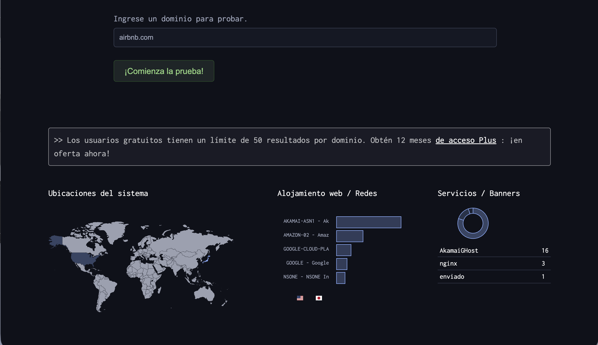
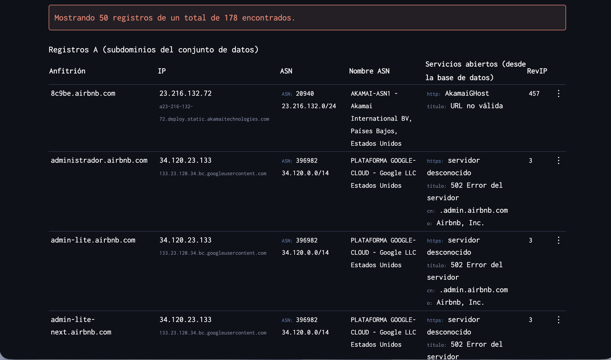
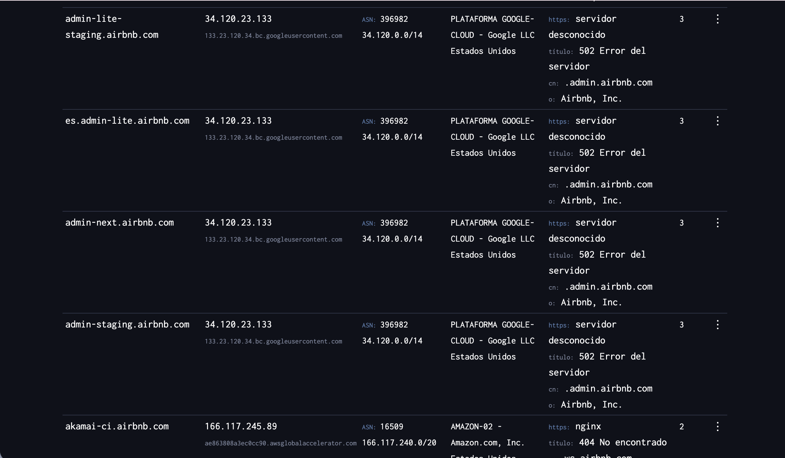
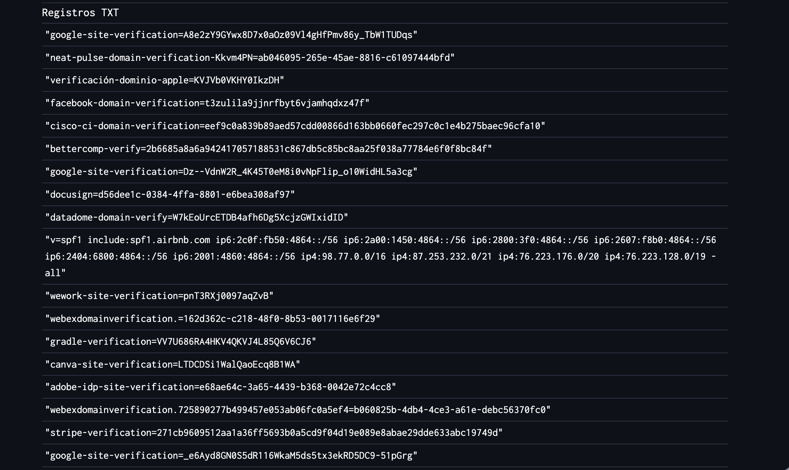

**Siguiente paso:** Comparar los subdominios obtenidos con los resultados de Subfinder y revisar las coincidencias, manteniendo el reconocimiento dentro del alcance autorizado.

---

## 3. Enumeración de subdominios — Subfinder

**Cuándo:** 2026-10-28, 11:40  
**Objetivo:** Identificar subdominios relacionados con `airbnb.com` mediante fuentes pasivas y respetando el alcance autorizado.

**Qué hice:**

Ejecuté Subfinder desde Kali Linux con el parámetro `-silent`, que oculta mensajes informativos de la herramienta:

```bash
subfinder -d airbnb.com -silent
```

**Qué salió:**

La herramienta devolvió una lista de subdominios obtenidos de fuentes públicas. En las capturas se muestran los resultados identificados, incluidos nombres relacionados con distintos entornos y servicios.

No se realizó un escaneo activo de los sistemas encontrados.

**Evidencias:**

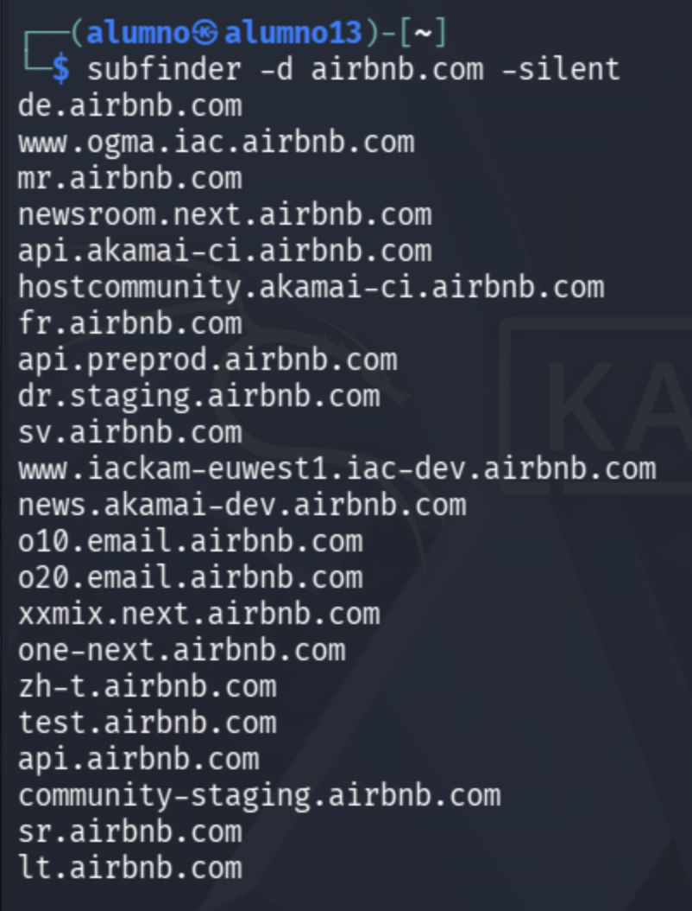

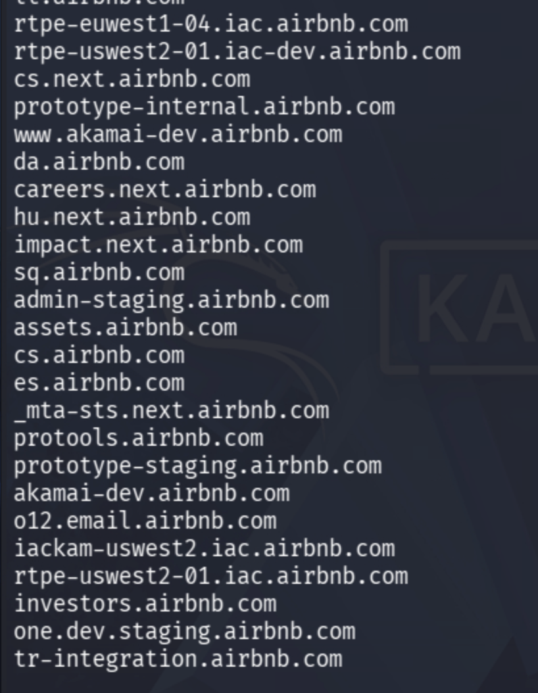

**Siguiente paso:** Consultar una fuente pública de huella tecnológica para obtener información sobre las tecnologías y el alojamiento web.

---

## 4. Huella tecnológica — Netcraft

**Cuándo:** 2026-10-28, 12:05  
**Objetivo:** Consultar información pública sobre la infraestructura web asociada a `airbnb.com`.

**Qué hice:**

Accedí al informe público de Netcraft:

https://sitereport.netcraft.com/?url=https://airbnb.com

Revisé los apartados disponibles del informe sin realizar pruebas intrusivas contra el servidor.

**Qué salió:**

Netcraft mostró información sobre la huella tecnológica y la infraestructura web del dominio. Las capturas adjuntas documentan los apartados revisados.

**Evidencias:**

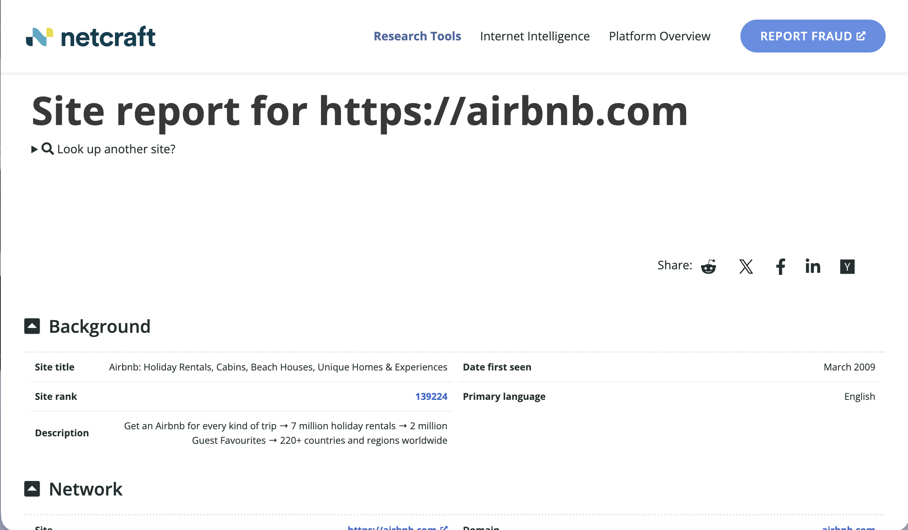

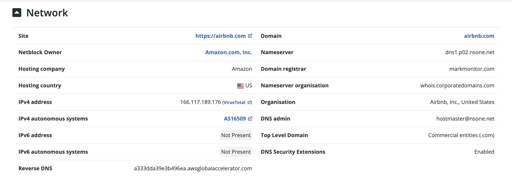

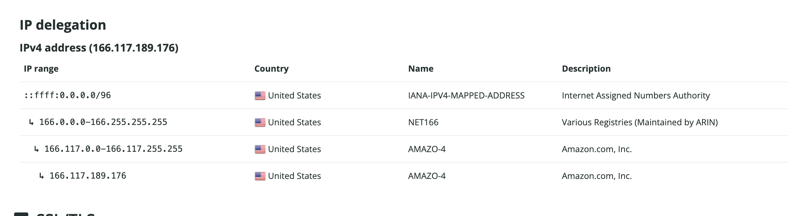

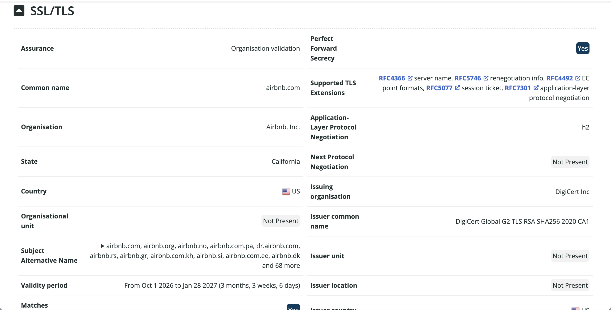

**Siguiente paso:** Consultar los ficheros públicos `robots.txt` y `security.txt`.

---

## 5. Ficheros públicos — robots.txt

**Cuándo:** 2026-10-28, 12:26  
**Objetivo:** Consultar el fichero público `robots.txt` de `airbnb.com`.

**Qué hice:**

Abrí el fichero desde el navegador:

https://www.airbnb.com/robots.txt

**Qué salió:**

El fichero contiene directrices para los rastreadores web. Entre las rutas que aparecen en las directivas `Disallow` se encuentran:

- Autenticación y cuentas: `/account`, `/login_with_redirect`, `/forget_password`.
- Gestión: `/home/dashboard`, `/manage-listing`, `/my_listings`.
- Transacciones: `/payments/book`, `/reservation`, `/checkout`.
- Otras rutas: `/api/v1/trebuchet` y `/messaging/ajax_already_messaged/`.

También aparece una directiva `Allow` para `/.well-known/apple-app-site-association`.

Estas directivas indican a los rastreadores qué rutas deben evitar o pueden rastrear. No demuestran por sí mismas que las rutas sean vulnerables ni que estén protegidas frente al acceso directo.

**Evidencias:**

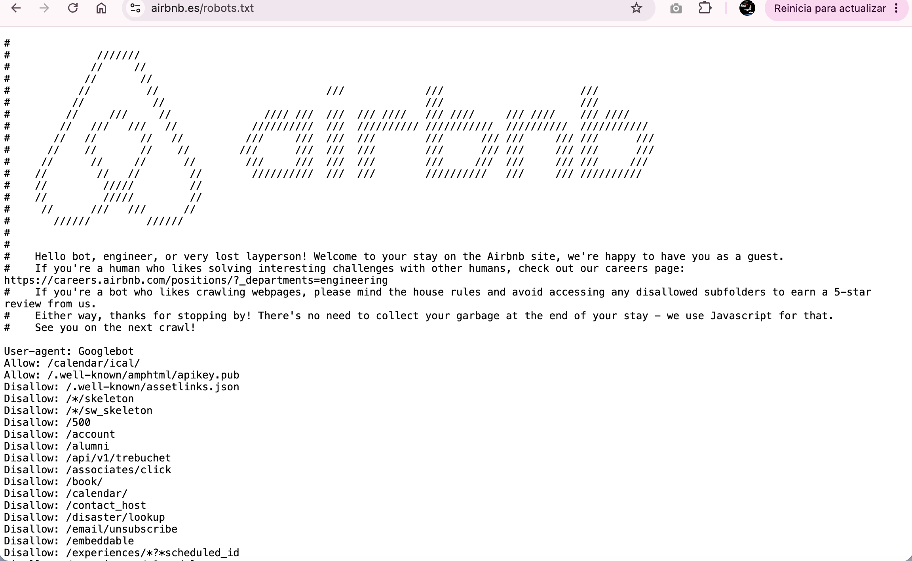

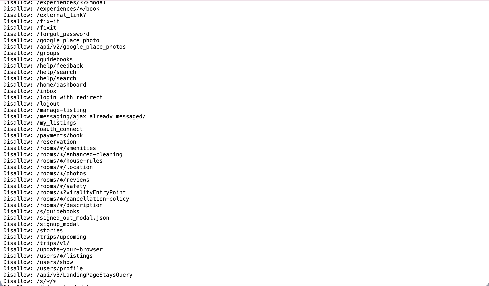

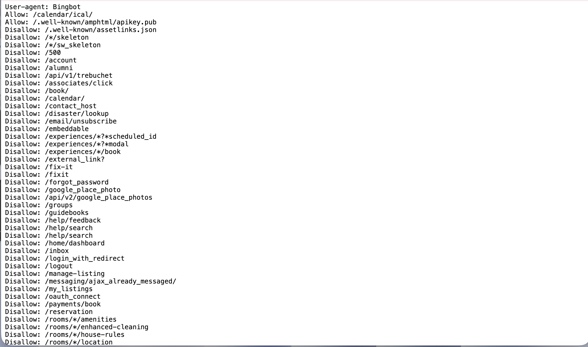

**Siguiente paso:** Consultar el fichero `security.txt` para localizar la política de seguridad y el canal oficial de reporte.

---

## 6. Fichero de seguridad — security.txt

**Cuándo:** 2026-10-28, 15:40  
**Objetivo:** Consultar información pública sobre la política de seguridad y el reporte de vulnerabilidades.

**Qué hice:**

Consulté el recurso de seguridad localizado a través de:

https://airbnb.es

Antes de considerar `airbnb.es` parte del objetivo auditado, debo comprobar si está incluido en el alcance oficial de HackerOne.

**Qué salió:**

El recurso consultado enlazaba con información sobre el programa de recompensas por errores (*Bug Bounty*) de Airbnb en HackerOne, sus condiciones y otros recursos relacionados con la seguridad. También mostraba una fecha de expiración indicada para junio de 2027.

**Evidencia:**

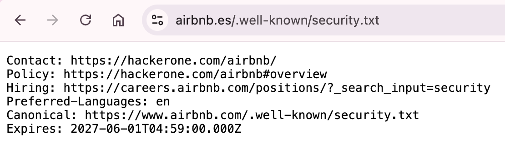

**Siguiente paso:** Revisar el alcance oficial del programa para confirmar qué dominios pueden investigarse en la siguiente fase.

---

## 7. Servicios expuestos — InternetDB de Shodan

**Cuándo:** 2026-10-28, 16:12  
**Objetivo:** Consultar información pública previamente recopilada sobre una dirección IP asociada a `www.airbnb.com`, sin realizar un escaneo de puertos.

**Qué hice:**

Primero consulté la resolución DNS:

```bash
dig +short www.airbnb.com
```

Entre las direcciones obtenidas seleccioné `96.16.88.137` y consulté la información disponible en InternetDB de Shodan:

https://internetdb.shodan.io/96.16.88.137

**Qué salió:**

InternetDB devolvió la siguiente información:

- IP consultada: `96.16.88.137`.
- Nombre de host: `a96-16-88-137.deploy.static.akamaitechnologies.com`.
- Puertos registrados: `80` y `443`.
- Etiqueta: `cdn`.
- Vulnerabilidades: el resultado no mostraba referencias a vulnerabilidades conocidas.

La información es compatible con el uso de infraestructura CDN de Akamai. Al tratarse de una dirección asociada a una CDN, no debe asumirse que todos los servicios de esa IP pertenecen exclusivamente a Airbnb.

**Evidencias:**

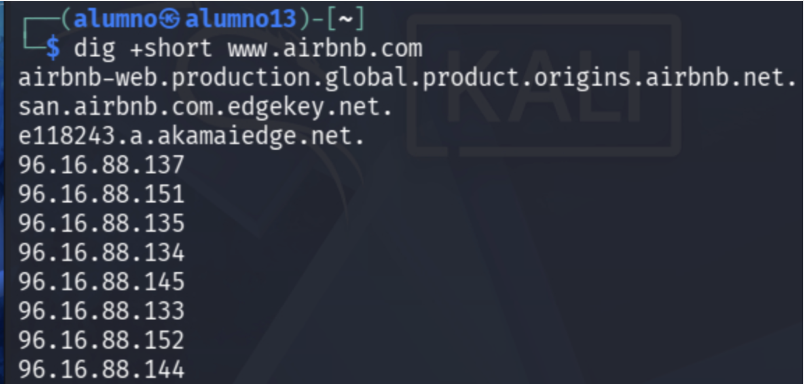

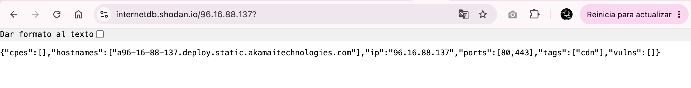

**Siguiente paso:** Realizar búsquedas avanzadas en Google para localizar documentos públicos indexados relacionados con el dominio.

---

## 8. Búsquedas avanzadas — Google dorks

**Cuándo:** 2026-10-28, 16:37  
**Objetivo:** Localizar documentos públicos indexados asociados a `airbnb.com` mediante operadores de búsqueda.

**Qué hice:**

Realicé las siguientes consultas en Google:

```text
site:airbnb.com filetype:pdf
site:airbnb.com filetype:docx
site:airbnb.com security
```

El operador `site:` restringe los resultados al dominio indicado y `filetype:` permite buscar un tipo de archivo concreto.

**Qué salió:**

- La consulta de PDF mostró los resultados recogidos en la captura.
- La consulta de DOCX no devolvió resultados relevantes para esta actividad.
- La búsqueda relacionada con seguridad mostró los resultados documentados en la captura.

**Evidencias:**

- **Búsqueda de PDF:**

  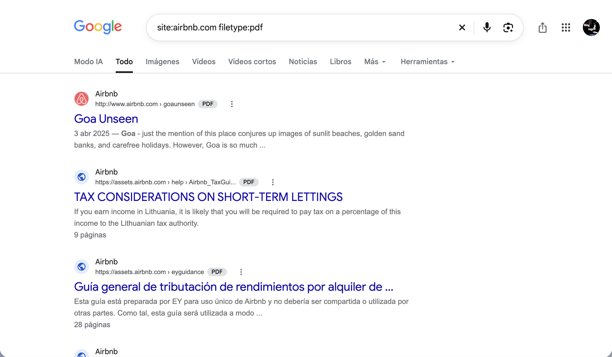

- **Búsqueda de DOCX:**

  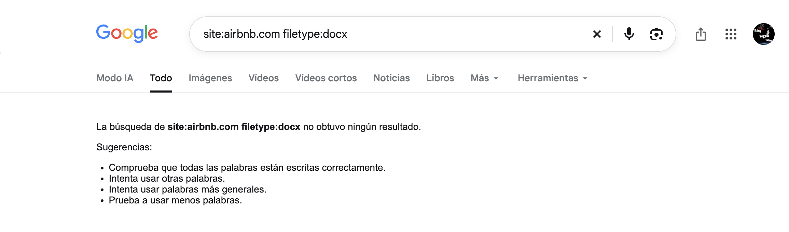

- **Búsqueda sobre seguridad:**

  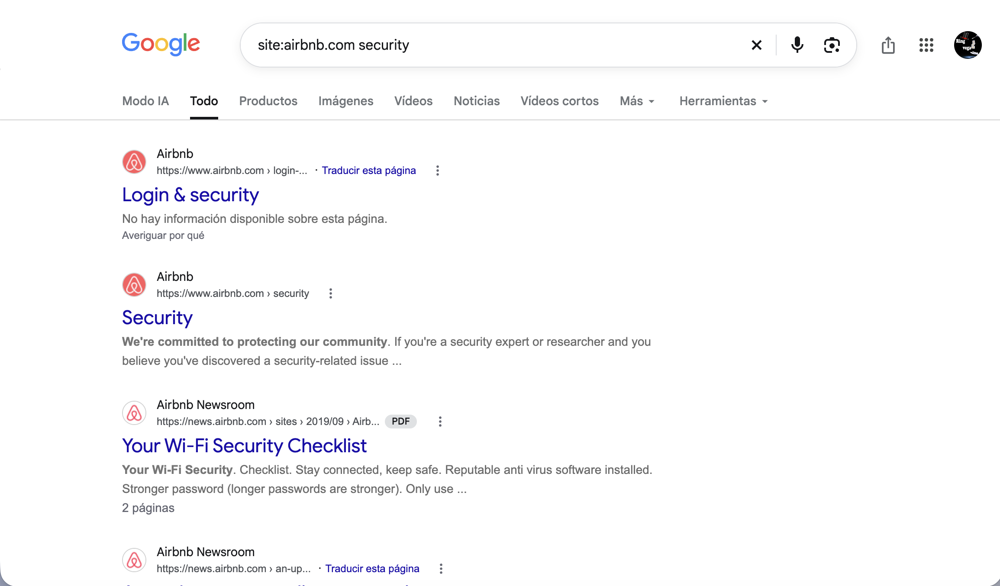

**Siguiente paso:** Buscar posibles direcciones de correo asociadas al dominio mediante fuentes públicas, sin contactar con las personas identificadas.

---

## 9. Búsqueda de correos — theHarvester y Hunter.io

**Cuándo:** 2026-10-28, 17:06  
**Objetivo:** Buscar información de contacto publicada en fuentes abiertas y relacionada con `airbnb.com`.

**Qué hice:**

Utilicé `theHarvester` con DuckDuckGo y Bing como fuentes de búsqueda. También consulté Hunter.io y realicé una búsqueda en Google con el siguiente operador:

```text
site:airbnb.com "@airbnb.com"
```

Consulta de Hunter.io:

https://hunter.io/search/airbnb.com

**Qué salió:**

- `theHarvester` no devolvió direcciones de correo electrónico ni direcciones IP en las consultas realizadas.
- Hunter.io mostró información sobre la empresa y direcciones de correo asociadas al dominio. No pude confirmar que todas las direcciones fueran válidas o estuvieran activas.
- La búsqueda de Google mostró los resultados recogidos en la captura.

**Evidencias:**

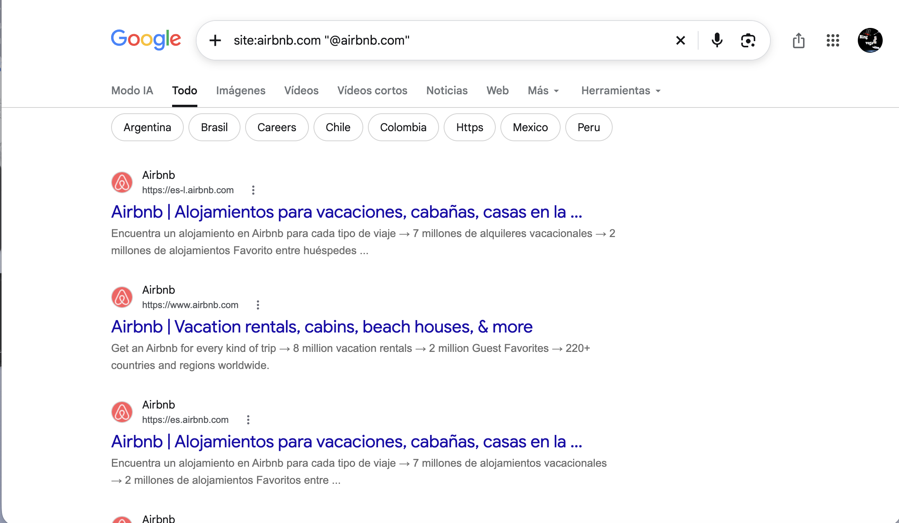

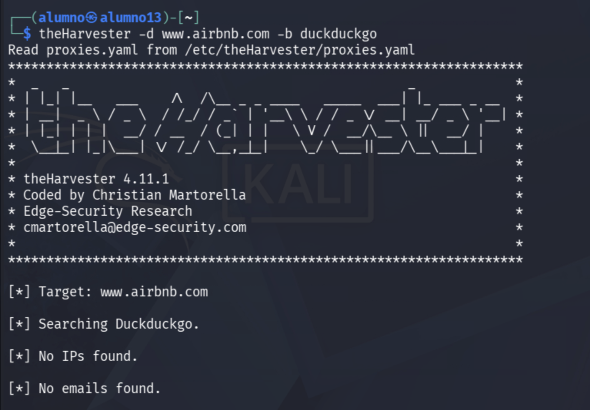

**Siguiente paso:** Consolidar los resultados verificados en el mapa de reconocimiento y comprobar que los activos incluidos estén dentro del alcance autorizado.